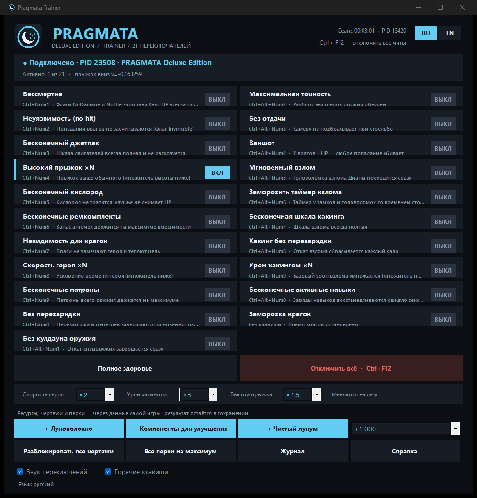
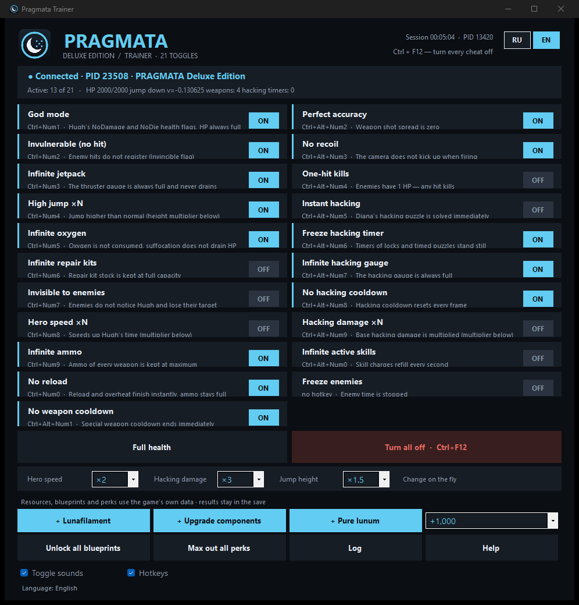

# Pragmata Trainer

[Русский](#русский) · [English](#english)

Трейнер для одиночной игры **PRAGMATA** (Capcom, RE Engine, Windows x64). 21 функция, ресурсы, разблокировка чертежей, интерфейс на русском и английском с переключением на лету.



---

## Русский

### Что это

Внешняя программа: при подключении загружает в игру небольшой мост `PragmataBridge.dll`. Мост находит в памяти виртуальную машину RE Engine и встроенную базу типов игры и работает с классами самой игры по их именам: здоровье (`HitPoint`), шкалы двигателей и взлома (`GaugeUnit`), оружие (`app.Weapon`), головоломки, инвентарь, принтер модулей. Каждый кадр мост выполняет действия на игровом потоке.

Только для одиночной игры. Трейнер не трогает защиту игры, сеть и файлы на диске.

### Установка и запуск

1. Скачайте `PragmataTrainer.exe` из [релизов](https://github.com/jestelf/PragmataTrainer/releases).
2. Запустите игру и загрузите сохранение.
3. Запустите трейнер — он подключится сам (порядок запуска не важен).

Если трейнер показывает «Нет доступа к процессу игры», запустите его от имени администратора. Журнал и настройки — в `%LOCALAPPDATA%\PragmataTrainer`.

### Функции и горячие клавиши

`Ctrl+F12` — отключить всё. Язык переключается кнопками **RU / EN** в правом верхнем углу.

| Клавиши | Функция | Что делает |
|---|---|---|
| Ctrl+Num1 | Бессмертие | Флаги NoDamage и NoDie, здоровье всегда полное |
| Ctrl+Num2 | Неуязвимость (no hit) | Попадания врагов не засчитываются |
| Ctrl+Num3 | Бесконечный джетпак | Шкала двигателей всегда полная |
| Ctrl+Num4 | Высокий прыжок ×N | Прыжок выше в 1.5–10 раз (множитель в панели) |
| Ctrl+Num5 | Бесконечный кислород | Кислород не тратится, удушье не снимает HP |
| Ctrl+Num6 | Бесконечные ремкомплекты | Запас ремкомплектов держится на максимуме |
| Ctrl+Num7 | Невидимость для врагов | Враги не замечают героя и теряют цель |
| Ctrl+Num8 | Скорость героя ×N | Герой движется быстрее (×1.5–3) |
| Ctrl+Num9 | Бесконечные патроны | Патроны всего оружия на максимуме |
| Ctrl+Num0 | Без перезарядки | Перезарядка и перегрев завершаются мгновенно |
| Ctrl+Alt+Num1 | Без кулдауна оружия | Откат спецоружия завершается сразу |
| Ctrl+Alt+Num2 | Максимальная точность | Разброс выстрелов обнулён |
| Ctrl+Alt+Num3 | Без отдачи | Камеру не подбрасывает при стрельбе |
| Ctrl+Alt+Num4 | Ваншот | У врагов 1 HP |
| Ctrl+Alt+Num5 | Мгновенный взлом | Головоломка взлома проходится сразу |
| Ctrl+Alt+Num6 | Заморозить таймер взлома | Таймеры замков и головоломок стоят на месте |
| Ctrl+Alt+Num7 | Бесконечная шкала хакинга | Шкала взлома всегда полная |
| Ctrl+Alt+Num8 | Хакинг без перезарядки | Откат взлома сбрасывается |
| Ctrl+Alt+Num9 | Урон хакингом ×N | Урон взлома ×2–10 |
| Ctrl+Alt+Num0 | Бесконечные активные навыки | Заряды навыков восстанавливаются |
| — | Заморозка врагов | Время врагов остановлено |

**Разовые действия** (результат остаётся в сохранении):

- **+ Луноволокно**, **+ Компоненты для улучшения**, **+ Чистый лунум** — добавить выбранное количество (10 – 100 000).
- **Разблокировать все чертежи** — всё оружие модульного принтера и все перки (вкладки «Взлом» и «Дополнения»).
- **Все перки на максимум** — открыть и прокачать перки.
- **Полное здоровье**.

Выключение функции возвращает исходные значения игры; закрытие трейнера выключает все функции.

### Поддерживаемая версия

PRAGMATA, `PRAGMATA.exe` сборки от 16.03.2026. При другой версии трейнер покажет «Другая версия игры» и не подключится — так безопаснее, чем писать в чужую сборку.

### Что проверено

Функции проверены автором в игре во время разработки на этой сборке. Отдельные ситуации (катсцены, особые бои, головоломки) могут вести себя иначе — если что-то не срабатывает, откройте issue и приложите строку из журнала трейнера.

### Антивирусы

Трейнер загружает DLL в процесс игры, поэтому некоторые антивирусы могут ругаться эвристически. Исходники открыты, exe можно собрать самостоятельно.

### Сборка

Нужны .NET Framework 4.x (`csc.exe` входит в Windows) и Visual Studio Build Tools с компилятором C++ x64.

```powershell
powershell -ExecutionPolicy Bypass -File build.ps1
powershell -ExecutionPolicy Bypass -File build.ps1 -VcVars "C:\Program Files\Microsoft Visual Studio\2022\BuildTools\VC\Auxiliary\Build\vcvars64.bat"
```

Результат — `dist\PragmataTrainer.exe` (мост встраивается в exe).

### Лицензия

MIT. Проект не связан с Capcom.

---

## English



### What it is

An external trainer for the single-player **PRAGMATA** (Capcom, RE Engine, Windows x64): 21 functions, resources, blueprint unlocking, RU/EN interface with live switching. On connection it loads a small bridge `PragmataBridge.dll` into the game. The bridge finds the RE Engine virtual machine and the game's built-in type database in memory and works with the game's own classes by name: health (`HitPoint`), thruster and hacking gauges (`GaugeUnit`), weapons (`app.Weapon`), puzzles, inventory, the module printer. Actions run on the game thread every frame.

Single-player only. The trainer does not touch the game's protection, networking or files on disk.

### Install and run

1. Download `PragmataTrainer.exe` from [releases](https://github.com/jestelf/PragmataTrainer/releases).
2. Start the game and load a save.
3. Start the trainer — it connects by itself (launch order does not matter).

If the trainer reports no access to the game process, run it as administrator. Log and settings live in `%LOCALAPPDATA%\PragmataTrainer`.

### Functions and hotkeys

`Ctrl+F12` turns everything off. Switch the language with the **RU / EN** buttons in the top right corner.

| Keys | Function | What it does |
|---|---|---|
| Ctrl+Num1 | God mode | NoDamage and NoDie flags, health always full |
| Ctrl+Num2 | Invulnerable (no hit) | Enemy hits do not register |
| Ctrl+Num3 | Infinite jetpack | Thruster gauge always full |
| Ctrl+Num4 | High jump ×N | Jump 1.5–10 times higher (multiplier in the panel) |
| Ctrl+Num5 | Infinite oxygen | Oxygen is not consumed, suffocation does not drain HP |
| Ctrl+Num6 | Infinite repair kits | Repair kit stock kept at maximum |
| Ctrl+Num7 | Invisible to enemies | Enemies do not notice Hugh and lose their target |
| Ctrl+Num8 | Hero speed ×N | Hugh moves faster (×1.5–3) |
| Ctrl+Num9 | Infinite ammo | Ammo of every weapon at maximum |
| Ctrl+Num0 | No reload | Reload and overheat finish instantly |
| Ctrl+Alt+Num1 | No weapon cooldown | Special weapon cooldown ends immediately |
| Ctrl+Alt+Num2 | Perfect accuracy | Shot spread is zero |
| Ctrl+Alt+Num3 | No recoil | The camera does not kick up when firing |
| Ctrl+Alt+Num4 | One-hit kills | Enemies have 1 HP |
| Ctrl+Alt+Num5 | Instant hacking | The hacking puzzle is solved immediately |
| Ctrl+Alt+Num6 | Freeze hacking timer | Lock and puzzle timers stand still |
| Ctrl+Alt+Num7 | Infinite hacking gauge | The hacking gauge is always full |
| Ctrl+Alt+Num8 | No hacking cooldown | Hacking cooldown resets |
| Ctrl+Alt+Num9 | Hacking damage ×N | Hacking damage ×2–10 |
| Ctrl+Alt+Num0 | Infinite active skills | Skill charges refill |
| — | Freeze enemies | Enemy time is stopped |

**One-time actions** (results stay in the save):

- **+ Lunafilament**, **+ Upgrade components**, **+ Pure lunum** — add the selected amount (10 – 100,000).
- **Unlock all blueprints** — every module printer weapon and every perk (Hacking and Add-ons tabs).
- **Max out all perks** — unlock and level up perks.
- **Full health**.

Turning a function off restores the game's original values; closing the trainer turns everything off.

### Supported version

PRAGMATA, `PRAGMATA.exe` build from 2026-03-16. On another version the trainer reports a different game version and does not connect — safer than writing into an unknown build.

### What is verified

The functions were tested in game by the author during development on this build. Some situations (cutscenes, special fights, puzzles) may behave differently — if something does not work, open an issue with the line from the trainer log.

### Antivirus

The trainer loads a DLL into the game process, so some antivirus products may raise heuristic warnings. The source is open and you can build the exe yourself.

### Build

Requires .NET Framework 4.x (`csc.exe` ships with Windows) and Visual Studio Build Tools with the x64 C++ compiler.

```powershell
powershell -ExecutionPolicy Bypass -File build.ps1
powershell -ExecutionPolicy Bypass -File build.ps1 -VcVars "C:\Program Files\Microsoft Visual Studio\2022\BuildTools\VC\Auxiliary\Build\vcvars64.bat"
```

Output: `dist\PragmataTrainer.exe` (the bridge is embedded in the exe).

### License

MIT. Not affiliated with Capcom.
